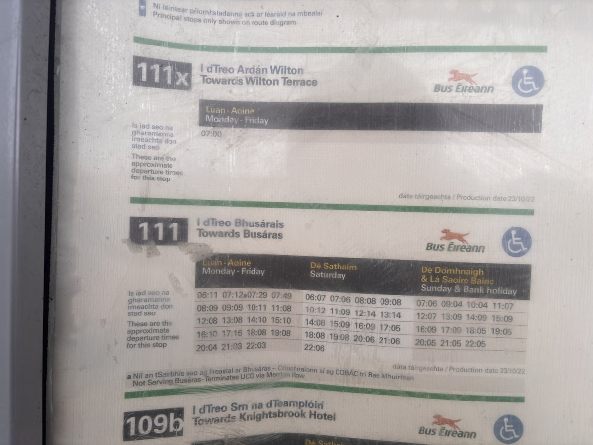
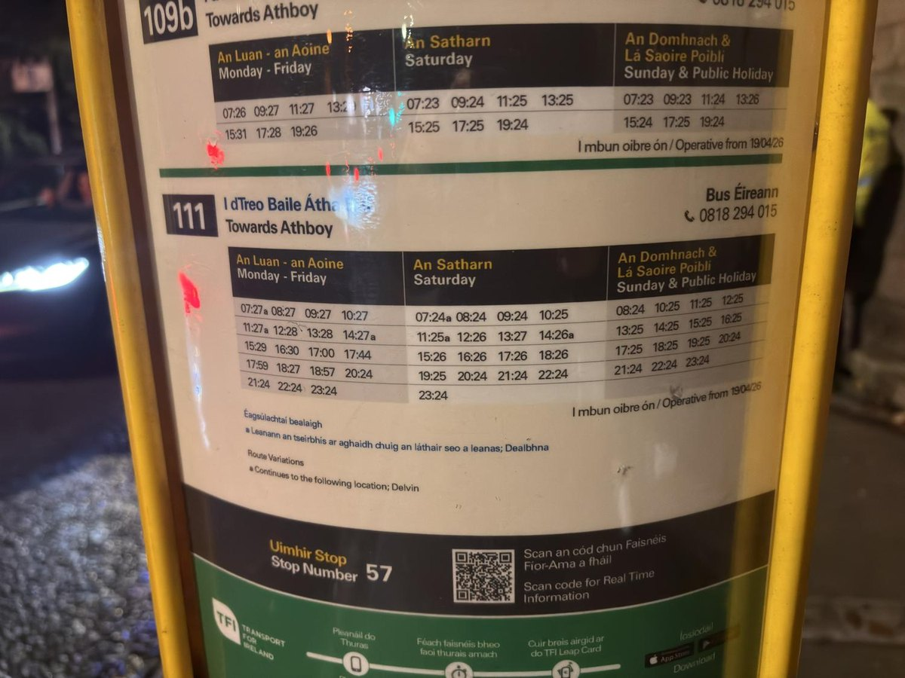

# Bus Punctuality Tracker

Data Centric Programming Assignment 2026 — [Assignment Brief](PROJECT_BRIEF.md)

**Status:** Proposal. Data collection has started; application development is planned.

# Questions

1. How many minutes do I wait for the bus on average?
2. How often does the bus arrive later than scheduled?
3. Does the average waiting time differ between rainy and dry weather?

# Data Dictionary

Each row will represent one bus I catch on route 111 (Athboy–Dublin), with observations at my boarding stop and destination. The dataset will contain nine columns and at least 20 real observations.

| Column | Type | Units / allowed values | How it is recorded |
|--------|------|------------------------|--------------------|
| `date` | Date | `YYYY-MM-DD` | Record the local date of the trip on the day it happens. |
| `direction` | Category | `Athboy to Dublin`, `Dublin to Athboy` | Record the direction of travel on route 111. |
| `stop_name` | Category | `Victorine Abbey`, `Dalymount` | Record `Victorine Abbey` when travelling towards Dublin for university, or `Dalymount` when travelling back towards Athboy. |
| `scheduled_arrival` | Time | Local time, `HH:MM`, 24-hour clock | Manually read and transcribe the published scheduled arrival time for that stop and service, before arrival. Do not use a live prediction. |
| `actual_arrival` | Time | Local time, `HH:MM`, 24-hour clock | Read my phone clock when the bus stops for boarding and record the time to the minute. |
| `time_of_day` | Category | `morning`, `afternoon`, `evening` | Classify the scheduled time: before 12:00 = morning; 12:00–16:59 = afternoon; 17:00–23:59 = evening. |
| `destination_arrival` | Time | Local time, `HH:MM`, 24-hour clock | Read my phone clock when the bus reaches the destination stop where I get off and record the time to the minute. |
| `wait_time` | Integer | Minutes, zero or greater | Measure the elapsed time from when I reach the boarding stop until the bus stops for boarding, using my phone clock or stopwatch, and record it to the nearest minute. |
| `weather` | Category | `rain`, `dry` | Observe the weather while waiting: record `rain` if it rains at any point during the wait; otherwise record `dry`. |

`delay_minutes` will be calculated during analysis as actual arrival minus scheduled arrival; it is not stored in the CSV. Positive delay means late, zero means on time at one-minute precision, and negative delay means early. Waiting time is measured separately: it starts when I reach the stop, regardless of the timetable. Any arrival crossing midnight will be noted in the collection diary so that the delay uses the correct dates.

Missing values are left blank, not recorded as zero. If the scheduled arrival is unknown, `time_of_day` is left blank and the delay cannot be calculated. Delay summaries will use only trips with both arrival times; waiting-time summaries will use only recorded waits, and weather comparisons will require both `wait_time` and `weather`.

The time-of-day boundaries above are the proposed rules and will be fixed before the first observation.

# Description of the project

I will track how long I wait and how reliably the buses I take on route 111 (Athboy–Dublin) arrive on time. I always board at Victorine Abbey when travelling towards Dublin for university and at Dalymount on the return journey towards Athboy. I will manually record the scheduled and actual arrival times at these boarding stops, my waiting time, the weather during the wait, and the time the bus reaches the destination stop where I get off.

I will collect at least 20 observations across my travel days during the remaining semester and aim to include both morning and evening trips. I will save them in `data/bus_trips.csv` and commit the CSV to GitHub every day I record data. Multiple trips on one day will be separate rows.

I will take a few photos of my collection process for this README, avoiding identifiable information about other passengers.

The application will use Python, MySQL, pandas, and matplotlib, with a simple command-line menu. I will run the local database service through my installed XAMPP environment. Users will be able to view trips, filter by date or direction, see average waiting time and the proportion of late buses, and compare average waiting times in rain and dry weather.

# Instructions for use

Start **MySQL Database** in XAMPP. Set up the project's virtual environment from the project directory:

```sh
python3 -m venv .venv
.venv/bin/python -m pip install -r requirements.txt
```

Run the connection check with `.venv/bin/python main.py`.

The script connects to `127.0.0.1:3306` and displays the database server version. It defaults to the local `root` account with an empty password. If your setup uses different credentials, set `MYSQL_USER` and `MYSQL_PASSWORD` in your terminal environment before running the script.

# How it works:

Planned workflow:

1. Record trips manually in the CSV.
2. Load them into a MySQL database running locally through XAMPP, validating dates, times, categories, missing fields, and non-negative waiting times. Check that each boarding stop matches the recorded direction. Flag inconsistent or unusual values for review without silently removing real observations.
3. Use SQL filtering, grouping, ordering, averages, and counts to summarise trips.
4. Analyse the records with pandas: calculate arrival delays from the recorded times, the average waiting time, and the count and percentage of buses arriving later than scheduled. Compare average waiting times for `rain` and `dry`, also considering direction where enough observations exist.
5. Show labelled matplotlib charts of waiting times over time, average waiting time by weather, and late versus on-time or early arrivals. Include sample counts for each summary.

# Findings

To be completed after analysing real observations. Results will describe the buses I actually catch, rather than every service on the route. I will discuss the small sample, unequal weather-group sizes, and how my arrival time at the stop, direction, or time of day could affect waiting-time comparisons. A weather association alone will not establish that rain causes longer waits.

## Collection diary and photos

- **2026-11-19:** First observation: the bus was scheduled to arrive at Victorine Abbey towards Dublin at 13:08 and actually arrived at 13:10. I waited 11 minutes in rain and reached my destination at 14:01. This is an afternoon trip. Added `destination_arrival`, `wait_time`, and `weather`; arrival delays will be calculated during analysis rather than stored in the CSV.

I photographed the posted timetables at both boarding stops. I use these signs to look up the scheduled times for route 111.



*Victorine Abbey — route 111 towards Dublin (Busáras).*



*Dalymount — route 111 towards Athboy.*


*My manual trip notes. Each line shows when I reached the stop, when the bus arrived, and when I reached my destination.*

# List of files in the project

| File | Purpose | Source |
|------|---------|--------|
| `README.md` | Proposal and future project documentation | Provided template, adapted with AI assistance |
| `PROJECT_BRIEF.md` | Assignment requirements | Provided assignment brief |
| `data/bus_trips.csv` | CSV headers and manually recorded bus observations | Own observations |
| `data/route_111_timetable.txt` | Timetable reference for both boarding stops | Transcribed from the posted timetables |
| `docs/images/` | Photos of the posted timetables and a screenshot of my trip notes | Own photos and notes |

Application files will be listed when added.

# References

- [Assignment brief](PROJECT_BRIEF.md) and the README template.
- Bus Éireann route 111 timetables posted at Victorine Abbey and Dalymount. See the [transcribed timetable](data/route_111_timetable.txt).

# What I am most proud of in the assignment

To be completed as the project progresses.

# What I learned

To be completed with reflections on data collection, analysis, and development.
